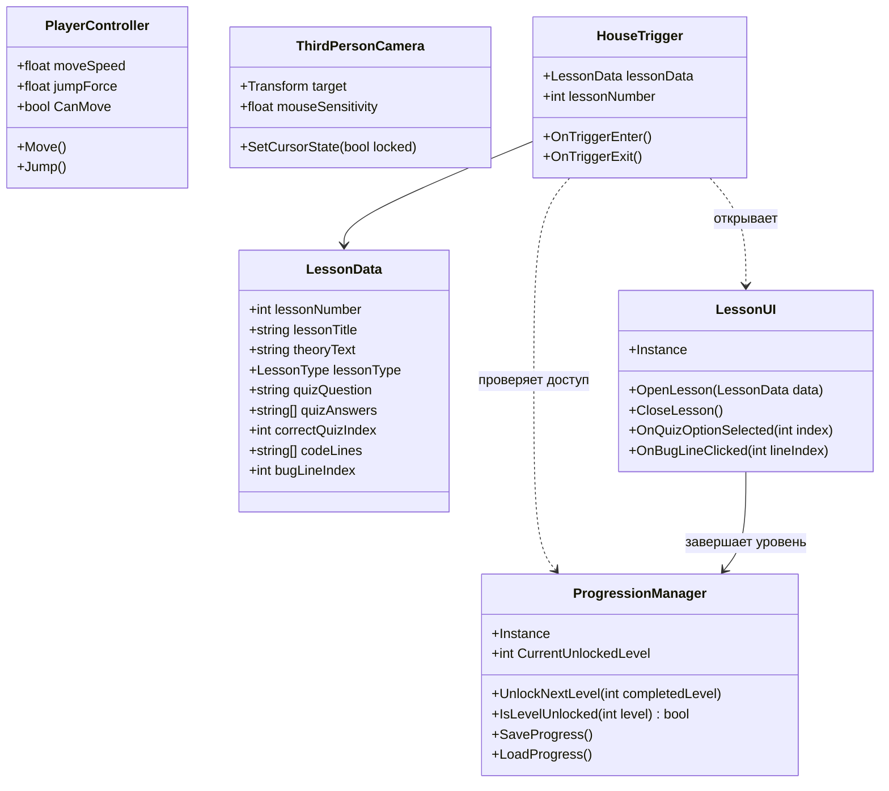

# Game Design Document (GDD) & Дорожная карта проекта «Jois»

**Название проекта:** Jois — Обучающая 3D-игра по основам C++  
**Автор проекта:** Шушпанов Н.А.  
**Учебная группа:** АСУб-26-2  
**Дисциплина / Период:** 1 курс, 1 семестр  
**Целевой срок разработки:** 21 день  
**Репозиторий проекта:** [https://github.com/NikiBy/Jois.git](https://github.com/NikiBy/Jois.git)  

---

## 1. Концепция и Vision игры

### 1.1. Главная цель
Создать интерактивное обучающее приложение в формате 3D-игры, которое помогает студентам первого курса в доступной, наглядной и игровой форме освоить ключевые концепции базового курса языка программирования C++ (программа 1-го семестра).

### 1.2. Жанр и сеттинг
* **Жанр:** 3D Serious Game / Educational Adventure / Обучающий квест.
* **Сеттинг:** Спокойная открытая 3D-локация («Деревня программистов» / «Остров C++»), на которой расположены 10 пронумерованных домиков-уровней.
* **Целевая платформа:** WebGL (браузер) и Windows Standalone (.exe).
* **Движок:** Unity 6 (URP — Universal Render Pipeline).
* **Язык разработки игры:** C#.
* **Изучаемый в игре язык:** C++.

### 1.3. Ключевые принципы игрового дизайна
1. **Дружелюбное обучение (Friendly Learning):** Никаких жестких наказаний, таймеров или потери жизней при ошибке. Если студент ошибается, игра даёт подсказку с объяснением и позволяет попробовать снова.
2. **Data-Driven Architecture:** Весь учебный материал хранится в ассетах `ScriptableObject`, отделён от интерфейса и логики, что позволяет легко расширять и редактировать учебный курс без изменения кода.
3. **Наглядность и интерактивность:** 50% уровней проверяют понимание концепций (тесты с выбором ответа), а 50% развивают практический навык чтения и отладки кода («Найди ошибку в коде» с интерактивными строками).

---

## 2. Игровой процесс (Gameplay & Core Loop)

### 2.1. Цикл взаимодействия (Core Loop)
```
[ Свободное исследование 3D-мира персонажем ]
                     ↓
[ Подход к активному Домику Уровня (подсвечен маяком) ]
                     ↓
[ Подсказка на экране: «Нажмите [E], чтобы войти» ]
                     ↓
[ Нажатие клавиши 'E' → Открытие 2D-окна Урока ]
   • Движение персонажа замораживается
   • Курсор мыши разблокируется для кликов
   • Отображается карточка с теорией C++
                     ↓
[ Интерактивное испытание ]
   • Тип А: Тест (Quiz) — 3 варианта ответа с моментальной подсветкой
   • Тип Б: Поиск ошибки (Find Bug) — интерактивный листинг с номерами строк
                     ↓
[ Ошибка ]                             [ Успех ]
   • Строка/кнопка мигает красным         • Зелёная подсветка правильного ответа
   • Выводится текст подсказки            • Выводится подробное объяснение
   • Мгновенная возможность повтора       • Кнопка «Завершить урок» активна
                                                 ↓
                                       [ Разблокировка Домика N + 1 ]
                                          • Сохранение в PlayerPrefs
                                          • Обновление счётчика в HUD (N / 10)
                                          • Снятие замка со следующего домика
```

### 2.2. Управление
| Действие | Клавиша / Устройство | Описание |
|---|---|---|
| Движение | `W`, `A`, `S`, `D` / Стрелки | Перемещение персонажа по плоскости XZ |
| Вращение камеры | Движение мыши | Орбитальная камера от третьего лица |
| Прыжок | `Пробел` | Базовый прыжок с учётом гравитации |
| Взаимодействие | `E` | Вход в домик при нахождении в зоне триггера |
| Закрытие урока | `Esc` / Кнопка «Закрыть» | Закрытие модального окна и возврат в 3D |
| Клики по UI | Левая кнопка мыши (ЛКМ) | Выбор вариантов ответа или строк кода |

---

## 3. Детальная спецификация 10 уровней (Учебная программа C++)

Курс разделён по принципу **50/50**: 5 уровней на концептуальное понимание (Quiz) и 5 уровней на поиск ошибок в коде (Find Bug).

---

### Уровень 1: Врата C++ (Quiz)
* **Тема:** Структура программы, функция `main()`, директива `#include <iostream>`, `return 0`.
* **Теоретическая карточка:**
  > Любая исполняемая программа на C++ обязана содержать точку входа — функцию `main()`. Директива `#include <iostream>` подключает заголовочный файл стандартной библиотеки для работы со стандартными потоками вывода (`std::cout`) и ввода (`std::cin`).
  > Инструкция `return 0;` сигнализирует операционной системе, что программа завершилась корректно и без ошибок.
* **Пример кода в теории:**
  ```cpp
  #include <iostream>

  int main() {
      std::cout << "Hello, World!" << std::endl;
      return 0;
  }
  ```
* **Вопрос:** С какой функции операционная система всегда начинает выполнение программы на C++?
* **Варианты ответов:**
  1. `start()`
  2. `int main()` *(Правильный ответ)*
  3. `program()`
* **Объяснение при успехе:** Верно! Стандарт языка C++ строго определяет функцию `int main()` как обязательную точку входа в консольное приложение.
* **Подсказка при ошибке:** Вспомните, как называется «главная» функция, от английского слова «main».

---

### Уровень 2: Лавка типов (Find Bug)
* **Тема:** Базовые типы данных (`int`, `double`, `float`, `char`, `bool`) и строгая статическая типизация.
* **Теоретическая карточка:**
  > Язык C++ — язык со статической строгой типизацией. Переменная каждого типа может хранить только совместимые с ней значения:
  > - `int` — целые числа (`42`, `-5`).
  > - `double` / `float` — числа с плавающей точкой (`3.14`).
  > - `char` — одиночный символ в одинарных кавычках (`'A'`).
  > - `bool` — логическое значение (`true` / `false`).
  > Попытка присвоить строковый литерал в кавычках целочисленной переменной вызывает ошибку компиляции!
* **Листинг кода с ошибкой:**
  ```cpp
  1: #include <iostream>
  2: 
  3: int main() {
  4:     int age = 19;
  5:     double gpa = 4.75;
  6:     char group = "A";
  7:     bool isStudent = true;
  8:     return 0;
  9: }
  ```
* **Строка с ошибкой:** Строка 6 (`char group = "A";`).
* **Объяснение при успехе:** Отлично! В строке 6 использованы двойные кавычки `"A"`, которые задают строковый литерал `const char[2]`. Для типа `char` необходимо использовать одинарные кавычки: `char group = 'A';`.
* **Подсказка при ошибке:** Обратите внимание на кавычки для символьного типа `char` в строке 6.

---

### Уровень 3: Почта ввода-вывода (Quiz)
* **Тема:** Потоковый ввод и вывод (`std::cin`, `std::cout`, операторы `<<` и `>>`).
* **Теоретическая карточка:**
  > Для вывода данных на экран используется поток `std::cout` в паре с оператором вставки в поток `<<` (стрелки направлены «в поток к экрану»).
  > Для считывания данных с клавиатуры используется поток `std::cin` с оператором извлечения из потока `>>` (стрелки направлены «из потока в переменную»).
* **Пример кода в теории:**
  ```cpp
  int x;
  std::cin >> x;        // Ввод: из потока в переменную x
  std::cout << x * 2;   // Вывод: значение выражения в поток cout
  ```
* **Вопрос:** Какой оператор используется для передачи значения переменной в поток вывода `std::cout`?
* **Варианты ответов:**
  1. `>>`
  2. `<<` *(Правильный ответ)*
  3. `->`
* **Объяснение при успехе:** Точно! Оператор `<<` (stream insertion operator) направляет поток данных в `std::cout`. Запомнить легко: стрелки указывают направление движения информации.
* **Подсказка при ошибке:** Оператор `>>` считывает из `std::cin`, а в `std::cout` данные «заталкиваются» стрелками `<<`.

---

### Уровень 4: Развилка решений (Find Bug)
* **Тема:** Условные операторы `if`, `else` и различие между присваиванием `=` и сравнением `==`.
* **Теоретическая карточка:**
  > В языке C++ оператор `=` — это оператор присваивания, а оператор `==` — оператор проверки на равенство.
  > Написание `if (x = 5)` не сравнивает `x` с `5`, а записывает `5` в `x` и возвращает результат `5` (который интерпретируется как `true`). Это одна из самых коварных ошибок начинающих программистов!
* **Листинг кода с ошибкой:**
  ```cpp
  1: #include <iostream>
  2: 
  3: int main() {
  4:     int score = 100;
  5:     if (score = 100) {
  6:         std::cout << "Победа!" << std::endl;
  7:     }
  8:     return 0;
  9: }
  ```
* **Строка с ошибкой:** Строка 5 (`if (score = 100)`).
* **Объяснение при успехе:** В точку! В условии оператора `if` случайно использовано одиночное присваивание `=` вместо проверки на равенство `==`. Корректная запись: `if (score == 100)`.
* **Подсказка при ошибке:** Посмотрите на условие в строке 5. Проверяется ли там равенство или происходит присваивание?

---

### Уровень 5: Мельница циклов (Quiz)
* **Тема:** Цикл с параметром `for`, условия завершения и индексация.
* **Теоретическая карточка:**
  > Цикл `for` состоит из трёх секций: инициализации, условия продолжения и шага:
  > `for (инициализация; условие; шаг) { тело_цикла; }`
  > Если счетчик начинает с `0` и выполняется пока `i < 5`, то `i` принимает последовательные значения: `0, 1, 2, 3, 4`.
* **Пример кода в теории:**
  ```cpp
  for (int i = 0; i < 5; i++) {
      std::cout << i << " ";
  }
  ```
* **Вопрос:** Сколько раз выполнится тело цикла `for (int i = 0; i < 5; i++)`?
* **Варианты ответов:**
  1. 4 раза
  2. 5 раз *(Правильный ответ)*
  3. 6 раз
* **Объяснение при успехе:** Верно! Цикл выполнится ровно 5 раз для значений счетчика `i = 0, 1, 2, 3, 4`. При `i = 5` условие `5 < 5` станет ложным, и цикл завершится.
* **Подсказка при ошибке:** Посчитайте на пальцах: 0, 1, 2, 3, 4. Сколько чисел получилось?

---

### Уровень 6: Склад массивов (Find Bug)
* **Тема:** Статические одномерные массивы, нулевая индексация и выход за границы (`Out of Bounds`).
* **Теоретическая карточка:**
  > Массивы в C++ индексируются строго с нуля (`0`).
  > Массив размера `N` (например, `int arr[5];`) содержит элементы с индексами от `0` до `N - 1`. Обращение к индексу `N` (`arr[5]`) является выходом за пределы массива и приводит к неопределенному поведению (Undefined Behavior) или падению программы!
* **Листинг кода с ошибкой:**
  ```cpp
  1: #include <iostream>
  2: 
  3: int main() {
  4:     int numbers[5] = {10, 20, 30, 40, 50};
  5:     std::cout << numbers[0] << std::endl;
  6:     std::cout << numbers[5] << std::endl;
  7:     return 0;
  8: }
  ```
* **Строка с ошибкой:** Строка 6 (`std::cout << numbers[5] << std::endl;`).
* **Объяснение при успехе:** Блестяще! В массиве из 5 элементов допустимы только индексы от `0` до `4`. Обращение `numbers[5]` в строке 6 читает не принадлежащую массиву память.
* **Подсказка при ошибке:** Внимательно посмотрите на индексы элементов массива `numbers[5]`. Есть ли в нём пятый индекс, если отсчёт начинается с 0?

---

### Уровень 7: Библиотека строк (Quiz)
* **Тема:** Класс `std::string`, заголовочный файл `<string>`, определение длины и конкатенация.
* **Теоретическая карточка:**
  > В стандартной библиотеке C++ для удобной работы с текстом используется класс `std::string` (требует `#include <string>`).
  > В отличие от Си-строк (`char*`), строки `std::string` поддерживают безопасное сложение оператором `+` (конкатенацию), а для получения количества символов в строке служат методы `.length()` или `.size()`.
* **Пример кода в теории:**
  ```cpp
  std::string name = "Jois";
  int len = name.length(); // len будет равно 4
  ```
* **Вопрос:** Какой метод класса `std::string` возвращает количество символов в строке?
* **Варианты ответов:**
  1. `.count()`
  2. `.length()` *(Правильный ответ)*
  3. `.sizeof()`
* **Объяснение при успехе:** Абсолютно верно! Методы `.length()` и `.size()` в `std::string` являются синонимами и возвращают текущую длину строки.
* **Подсказка при ошибке:** Вспомните английское слово, обозначающее «длина» (length).

---

### Уровень 8: Мастерская функций (Find Bug)
* **Тема:** Объявление и определение функций, тип возвращаемого значения, оператор `return`.
* **Теоретическая карточка:**
  > Если функция имеет возвращаемый тип, отличный от `void` (например, `int`, `double`, `bool`), она обязана вернуть значение соответствующего типа с помощью оператора `return`.
  > Отсутствие `return` в не-void функции приводит к непредсказуемым результатам при попытке использовать результат вызова.
* **Листинг кода с ошибкой:**
  ```cpp
  1: #include <iostream>
  2: 
  3: int multiply(int a, int b) {
  4:     int result = a * b;
  5: }
  6: 
  7: int main() {
  8:     int val = multiply(4, 5);
  9:     return 0;
  10: }
  ```
* **Строка с ошибкой:** Строка 4 (`int result = a * b;` / отсутствие return в теле функции перед строкой 5).
* **Объяснение при успехе:** Отличная работа! Функция `int multiply(...)` обязана возвращать целое число, однако в теле функции результат вычислен, но забыт оператор `return result;`.
* **Подсказка при ошибке:** Обратите внимание на функцию `multiply` — возвращает ли она посчитанный результат вызывающей программе?

---

### Уровень 9: Башня Памяти (Quiz)
* **Тема:** Указатели, адресация, разыменование (`*`) и взятие адреса (`&`).
* **Теоретическая карточка:**
  > Указатель (`int* ptr`) — это переменная, которая хранит адрес ячейки оперативной памяти другой переменной.
  > - Оператор `&` (взятие адреса) возвращает адрес переменной: `ptr = &x;`.
  > - Оператор `*` (разыменование указателя) обращается к значению, лежащему по адресу в указателе: `*ptr`.
* **Пример кода в теории:**
  ```cpp
  int x = 42;
  int* ptr = &x; // ptr хранит адрес переменной x
  // *ptr обращается к значению 42
  ```
* **Вопрос:** Что вернёт выражение `*ptr`, если указатель `ptr` хранит адрес целочисленной переменной `x = 42`?
* **Варианты ответов:**
  1. Адрес ячейки памяти переменной `x`
  2. Значение `42` *(Правильный ответ)*
  3. Значение `null`
* **Объяснение при успехе:** Точно! Операция разыменования `*ptr` («идти по адресу») возвращает само значение объекта, на который указывает `ptr`, то есть `42`.
* **Подсказка при ошибке:** Оператор `&` берет адрес, а оператор `*` разыменовывает указатель и достаёт значение.

---

### Уровень 10: Финальный Экзамен (Find Bug)
* **Тема:** Динамическое выделение памяти (`new`), освобождение ресурсов (`delete`) и утечки памяти.
* **Теоретическая карточка:**
  > В C++ память, выделенная в «куче» (heap) с помощью оператора `new`, не очищается автоматически сборщиком мусора!
  > Программист обязан вручную освобождать динамически выделенную память с помощью `delete` (для одиночных объектов) или `delete[]` (для массивов). Потеря указателя без вызова `delete` называется утечкой памяти (Memory Leak).
* **Листинг кода с ошибкой:**
  ```cpp
  1: #include <iostream>
  2: 
  3: void processData() {
  4:     int* dynamicArray = new int[100];
  5:     dynamicArray[0] = 42;
  6:     delete dynamicArray;
  7: }
  8: 
  9: int main() {
  10:     processData();
  11:     return 0;
  12: }
  ```
* **Строка с ошибкой:** Строка 6 (`delete dynamicArray;`).
* **Объяснение при успехе:** Вы успешно сдали финальный экзамен! Память для массива была выделена через `new int[100]`, поэтому освобождаться она обязана оператором `delete[] dynamicArray;`. Использование одиночного `delete` вместо `delete[]` приводит к неопределенному поведению!
* **Подсказка при ошибке:** Обратите внимание на строку 6: массив выделялся через `new[]`, а как он удаляется?

---

## 4. Архитектура проекта и технический дизайн

### 4.1. Диаграмма подсистем


### 4.2. Ключевые компоненты
1. **`LessonData.cs` (`ScriptableObject`):**
   - Универсальный контейнер для учебного контента.
   - Поддерживает перечисление `LessonType { Quiz, FindBug }`.
   - Хранит теоретический текст, вопрос и массив строк ответов (для Quiz) или массив строк листинга и индекс ошибочной строки (для FindBug).
2. **`LessonUI.cs`:**
   - Модальное окно, динамически формирующее элементы интерфейса в зависимости от `lessonType`.
   - Замораживает персонажа через `PlayerController.CanMove = false` и освобождает курсор.
   - Оснащено кнопкой «Завершить урок», которая становится доступной только после правильного решения.
3. **`HouseTrigger.cs`:**
   - Коллайдер-триггер у входа в домик.
   - Сверяется с `ProgressionManager.Instance.IsLevelUnlocked(lessonNumber)`.
   - Если уровень заблокирован, показывает предупреждение: *«Этот уровень пока закрыт! Сначала пройдите Домик {N-1}»*.
   - При активном уровне выводит подсказку *«Нажмите [E], чтобы войти»*.
4. **`ProgressionManager.cs`:**
   - Синглтон менеджера прогресса.
   - Сохраняет номер максимального открытого уровня в `PlayerPrefs` (ключ `Jois_UnlockedLevel`).
   - Оповещает сцену через C#-событие `OnLevelUnlocked`.
5. **`SceneSetupHelper.cs` (Editor):**
   - Утилита для автоматической генерации и разметки 10 домиков в сцене Unity, создания UI Canvas и EventSystem в один клик.

---

## 5. Детальный план реализации этапов (Roadmap)

### 📌 Этап 1: Архитектура данных (ScriptableObject) и интерактивные UI-модули
* [ ] **Задача 1.1:** Создать скрипт `LessonData.cs` со всеми сериализуемыми полями для `Quiz` и `FindBug`.
* [ ] **Задача 1.2:** Создать префабы/структуры динамических элементов UI:
  - Кнопка варианта ответа (`QuizOptionButton`).
  - Строка кода (`CodeLineButton`) с компонентами номера строки, текста кода и визуальной подсветки.
* [ ] **Задача 1.3:** Модернизировать `LessonUI.cs`:
  - Метод `SetupQuizUI(LessonData data)`: генерация кнопок, биндинг событий, цветная индикация (красный/зеленый).
  - Метод `SetupFindBugUI(LessonData data)`: генерация строк кода, обработка клика, вывод подсказки при промахе и объяснения при успехе.
  - Панель статуса/фидбека и кнопка разблокировки следующего шага.
* [ ] **Задача 1.4:** Обновить `HouseTrigger.cs` для чтения данных из `LessonData`.

### 📌 Этап 2: Система прогрессии, навигация и генерация 10 домиков
* [ ] **Задача 2.1:** Написать синглтон `ProgressionManager.cs` с методами `UnlockNextLevel()`, `IsLevelUnlocked()`, сохранением в `PlayerPrefs`.
* [ ] **Задача 2.2:** Создать HUD-интерфейс в углу экрана со счётчиком прогресса (`Пройдено: N / 10`).
* [ ] **Задача 2.3:** Добавить на домики визуальные индикаторы (зелёный маркер/маяк над активным домиком, иконка замка на закрытых).
* [ ] **Задача 2.4:** Расширить `SceneSetupHelper.cs` генерацией 10 домиков вдоль кольцевой дороги/поляны.

### 📌 Этап 3: Полное наполнение 10 уровней C++
* [ ] **Задача 3.1:** Создать 10 ассетов `LessonData_Level1.asset` – `LessonData_Level10.asset` в папке `Assets/Data/Lessons/`.
* [ ] **Задача 3.2:** Заполнить все ассеты точными данными из Раздела 3 настоящего GDD.
* [ ] **Задача 3.3:** Назначить ассеты соответствующим домикам `House_Level_1` – `House_Level_10`.

### 📌 Этап 4: Полировка, звук, финальный экран и релизные билды
* [ ] **Задача 4.1:** Добавить звуковые эффекты (SFX): клик по кнопке, звук правильного ответа, звук ошибки, фанфары завершения игры.
* [ ] **Задача 4.2:** Создать финальный модальный экран поздравления с получением сертификата «C++ Junior Coder» после завершения 10-го уровня.
* [ ] **Задача 4.3:** Тестирование всего пути игрока от 1-го до 10-го уровня.
* [ ] **Задача 4.4:** Сборка билда WebGL (для публикации на itch.io) и Windows Standalone x64 (.exe).

---

## 6. План коммитов (Цель: 40+ коммитов)

* `01-05`: Инициализация репозитория, документация, проект Unity, контроллер персонажа. *(Выполнено)*
* `06-11`: Скрипты взаимодействия, UI канвас, фиксы Input System и Raycast. *(Выполнено)*
* `12-15`: Исчерпывающий Game Design Document и архитектура ScriptableObject.
* `16-20`: Реализация модуля Quiz (динамические кнопки, подсветка ответов, подсказки).
* `21-25`: Реализация модуля Find Bug (построчный листинг кода, выбор строки, обратная связь).
* `26-29`: ProgressionManager, автосохранение прогресса в PlayerPrefs, проверка блокировок домиков.
* `30-33`: Наполнение и настройка уроков 1–5 (Введение, Типы, Ввод-вывод, If/Else, Циклы).
* `34-37`: Наполнение и настройка уроков 6–10 (Массивы, Строки, Функции, Указатели, Финал).
* `38-41`: Разметка окружения из 10 домиков, маяки, замки, HUD счетчик уровней.
* `42-45`: Звуковое сопровождение (SFX), экран победы, финальные билды WebGL и Windows Standalone.
